# 📊 UIII Act3: Importación y Descripción de Datos
## Iker Montoya 0105 
# empleado de indsutria 
> **🎓 Asignatura:** Soluciona problemas de Machine Learning  
> **📚 Nivel:** Tercer semestre de preparatoria  
> **🤖 Especialidad:** Inteligencia Artificial  
> **📈 Dificultad:** Cero a principiante  
> **🐍 Lenguaje:** Python  
> **🛠️ Herramientas:** Visual Studio Code, Pandas, Matplotlib y CSV 
## tTABLA ORIGINAL DE RUTINAS DE NUTRICIÓN 
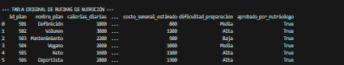
## Leer los datos desde el archivo CSV
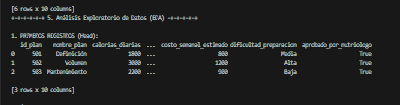
## . Análisis Exploratorio de Datos (EDA)
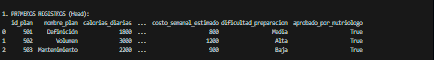

##  ÚLTIMOS REGISTROS (Tail):
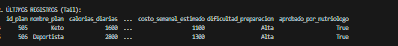

# 6. Dimensiones y estructura 
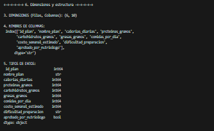

## Estadísticas y limpieza 
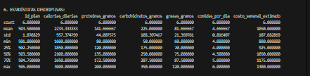

 ## VALORES FALTANTES (Nulls):
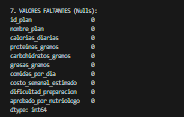

# 8. REGISTROS DUPLICADOS:Y  VALORES ÚNICOS POR COLUMNA:
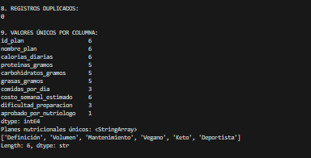

## Analisis especifico 
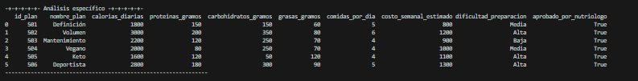

# planes ordenados en todos los ordenes 
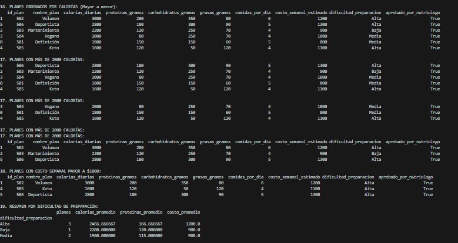

# matriz de correlacion 
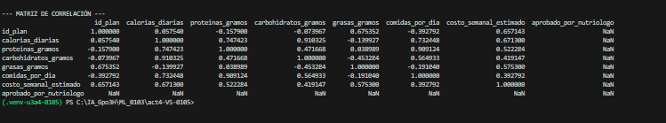

## grafica de barras 
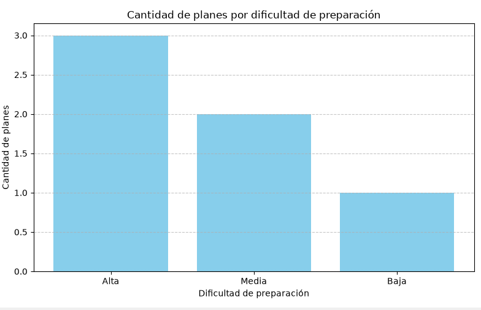

## grafica de barras por plan de nutricion 
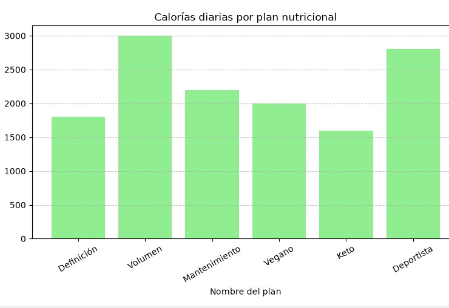

# distribucion de proteinas 
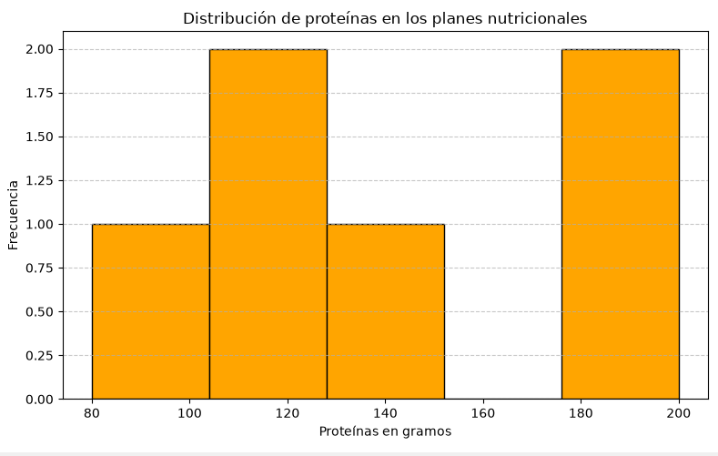

# grafica de puntos plan de nutricion 
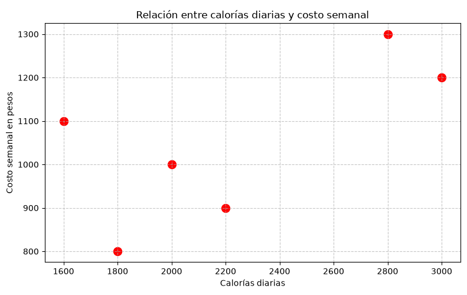

# distribucion de costos semanales y planes 
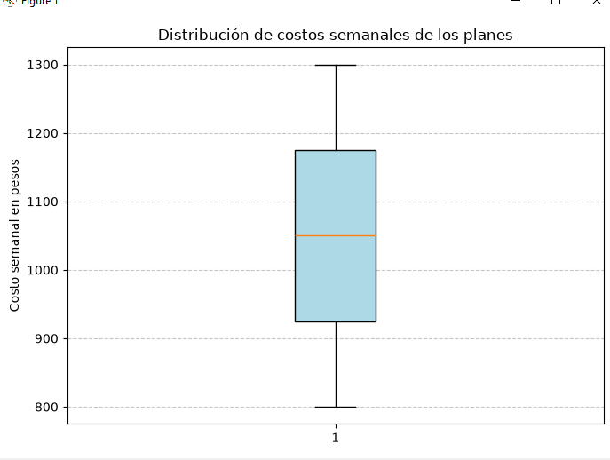

## matriz de variables numericas 
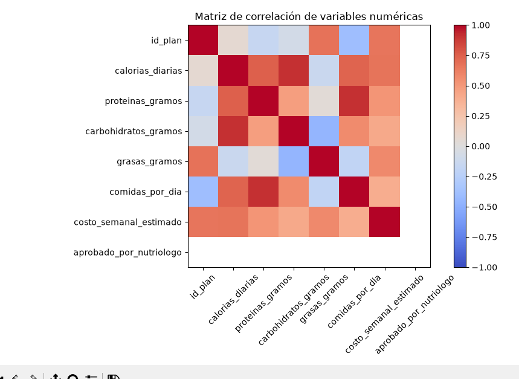